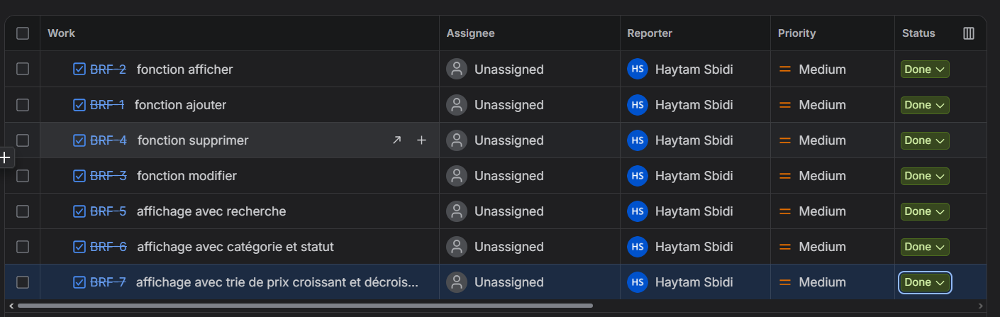

# AutoPark — Starter apprenant

## Description du projet

**Auto park** une application web interactive developée pour **Atlas Auto** permettant de gérer les voitures des agences de location.

Cette application permet de gerer et stocker les informations concernant le stock de voitures appartenant à chaque location.

Les utilisateurs de cette application peuves ajouter de nouvelle voitures au stock, les modifier et les suprimer ainci que effectuer des recherches, modifier la maniére d'affichage et trier les voitures selon leurs prix.

Le projet est développé avec **HTML5, CSS3 et JavaScript Vanilla**, sans framework, backend ni base de données main avec un stockage local.

---

## Objectifs du projet

- Créer une application web interactive et responsive.
- Manipuler le DOM avec JavaScript.
- Gérer les événements utilisateur.
- Ajouter et supprimer dynamiquement des voitures.
- Valider les données d'un formulaire.
- Afficher des messages d'erreur et de confirmation.

## Fonctionalitées de base 

**Affichage de voitures:**
- afficher d'une maniere dinamique les voitures disponibles / louées / en maintenace 
- presentation de voitures sous forme de tableau

**Ajout de nouvelle voitures:**
- ajout simple et direct de voitures avec leurs marques, model, immatriqulation et les donner un prix par jour
- assigner à chaque voiture une catégorie et un statut 

**suppression d'une demande:**
- Chaque demande possède un bouton « Supprimer ».
- La liste est actualisée automatiquement après suppression.

**recherche, filtrage et tri**
- l'affichage du tableau depand du mot recherchée et de la categorie ou statut choisis.
- l'affichage peut aussi etre d'un ordre de prix croissant ou decroissant

## devision de travail avec jira 

